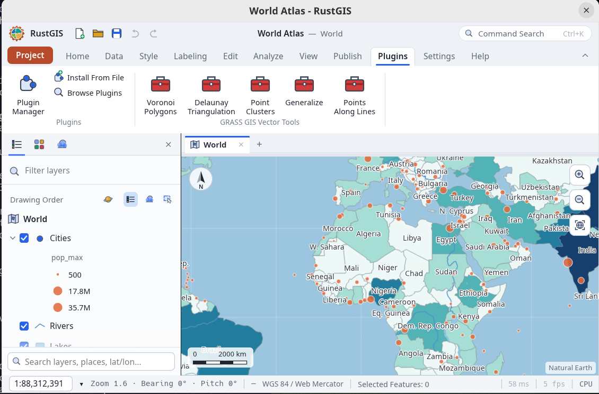

# GRASS GIS tools for RustGIS

A [RustGIS](https://github.com/opengeos/RustGIS) **process plugin** that runs GRASS GIS modules:
vector modules as geoprocessing tools, raster modules as commands with a panel. It is a working
prototype for
[opengeos/RustGIS#1249](https://github.com/opengeos/RustGIS/issues/1249), which proposes the same
bridge as a crate in the RustGIS tree.
[GRASS_INTERFACE.md](GRASS_INTERFACE.md) is the survey of RustGIS's extension points this was
designed from, written before the prototype and partly superseded by it.



GRASS is not bundled, linked or copied here. Each run spawns the `grass` launcher already
installed on the machine, and every tool's form is read from that installation at build time with
`<module> --interface-description`. Nothing of GRASS — code, help text or module descriptions —
lives in this repository, which is why a GPL-2.0-or-later program can be driven from an
Apache-2.0 GIS this way.

## What it offers

Five vector modules as **tools**, with their forms generated from GRASS's own metadata:

| Tool | Module |
|---|---|
| Voronoi Polygons | `v.voronoi` |
| Delaunay Triangulation | `v.delaunay` |
| Point Clusters | `v.cluster` |
| Generalize | `v.generalize` |
| Points Along Lines | `v.to.points` |

Three raster modules as **commands**, driven from the **GRASS Raster** panel:

| Command | Module | Result |
|---|---|---|
| Slope | `r.slope.aspect` | steepness, in degrees or percent |
| Aspect | `r.slope.aspect` | the direction each cell faces, clockwise from north |
| Viewshed | `r.viewshed` | what is visible from the centre of the map |

The panel chooses the raster layer, the slope's unit, the viewer's height and the viewshed's
range. A command opens no dialog, so without a panel these could only ever run with fixed
defaults.

## Install

Needs GRASS GIS 8 and Python 3 on the machine. `RUSTGIS_GRASS` names the launcher if it is not
on the `PATH`.

```sh
python3 generate_manifest.py                      # read the forms from your GRASS
rustgis-cli plugins install ./rustgis-grass-plugin
rustgis-cli run --sample \
  --cmd 'gp.run={"tool":"plugin:grass-vector/v-voronoi","params":{"input":"Cities"}}'
rustgis-cli run --cmd 'layer.addData={"path":"dem.tif"}' \
  --cmd 'plugin:grass-vector/raster-slope={}'
```

The raster commands need the `edit` and `files` permissions, which the generated manifest asks
for: they are what lets the plugin have RustGIS write and read the GeoTIFFs it works on. The
vector tools need neither.

In the desktop app: **Plugin Manager › Settings › Add Plugin Folder…**. The tools then appear in
the Tools pane under **Plugins ›** and as a group on the **Plugins** ribbon tab, where the
**GRASS Raster** button opens the panel the raster commands are run from. A process plugin is **not sandboxed**: it runs programs as
you do, which is how it can reach GRASS at all.

`plugin.json` and `modules.json` are **not committed**: they carry GRASS's own parameter labels,
which are part of its GPL documentation. They are generated from your installation by
`generate_manifest.py`, which is also why that step comes before installing the plugin.

## How a vector run works

1. A throwaway GISDBASE is made in a temporary folder, with a UTM project for the data's own area
   and an EPSG:4326 project to export through. The whole folder is deleted afterwards, so no
   `.gislock` outlives a run.
2. The input layer's GeoJSON is imported with `v.import`, which reprojects it into UTM, so the
   module's distances and areas are in metres rather than degrees.
3. **The computational region is set from the input layer** (`g.region vector=…`).
4. The module runs, then `v.proj` and `v.out.ogr` bring the result back as longitude/latitude
   GeoJSON.
5. Every run reports the projection it used, the region it set, and each distinct GRASS warning
   with how often it was raised.

## How a raster run works

A tool cannot do this. RustGIS's plugin ABI gives a tool `layer`, `vectorLayer`, `polygonLayer`,
`pointLayer`, `field`, `numericField`, `number`, `text`, `choice`, `bool` and `file` parameters,
and lets it return GeoJSON layers, tables, a selection and messages: **no raster either way**,
and a tool "can log, but makes no host requests". A plugin *command* may call any RustGIS
command its permissions allow, which is enough to carry a raster in and out:

1. `host.layers` lists the map's layers; the panel's tree chooses one of the rasters (without a
   choice, the active one, or the only one).
2. `share.exportRaster` writes it as a GeoTIFF (`files`).
3. A throwaway GISDBASE is made, with a project taking **the raster's own coordinate system**, so
   nothing is reprojected on the way in or out. `r.in.gdal` imports it and `g.region raster=…`
   sets the region from it.
4. The module runs, and `r.out.gdal` writes the result.
5. `layer.addData` adds that file as a raster layer (`files` and `edit`), and the run reports the
   projection, the region's cells and extent, what the numbers mean, and each distinct GRASS
   warning with its count.

The result stays in `~/.cache/rustgis-grass-plugin/`, because RustGIS reads the file when the
layer is added and keeps the path; each message says where it is.

### The two-minute cap

RustGIS stops a plugin command after two minutes. The run therefore carries its own deadline and
gives up with a readable reason instead of being killed with a half-written file behind it.
Measured here, `r.slope.aspect` end to end, project creation, export and import included:

| Raster | Wall time |
|---|---|
| 500 × 500 (250,000 cells) | 3.1 s |
| 4,000 × 4,000 (16,000,000 cells) | 9.5 s |

So the cap is generous for a per-cell module and useless for `r.watershed` on a national DEM.
That ceiling, not the ABI, is now the reason raster work belongs in a crate rather than a plugin.
`generate_manifest.py` still prints what it had to leave out of each **tool**, and the mapper
refuses every raster parameter there rather than offering one that cannot work.

## Watch out

- **The region is not optional.** A freshly created GRASS project has a region of one cell at the
  origin. Run `v.voronoi` without setting it and GRASS says `Found 0 points/centroids`; a raster
  module would quietly write a single cell. Step 3 above exists because of that.
- A run costs about ten seconds of project creation, import and export even for a dozen points,
  because each module call builds its own database. A session-scoped mapset would amortise it.
- Several input maps and 3D (`r3.*`) data are not offered; a raster reaches a command, never a
  tool.
- A tree widget only keeps a value that was among the nodes the plugin last sent, so a script
  passing `{"panel": {"raster": "3"}}` must run `raster-state` first, as the panel does when it
  opens.
- `v.generalize` has one parameter too many for a plugin tool's limit of 32; the generator keeps
  the required ones and says which it dropped.

## Tests

```sh
python3 -m pytest -q tests
```

The mapping tests use XML written for the tests and the raster tests cover the decisions made
around a module run, so neither needs GRASS. Two integration tests run real modules and skip
themselves when GRASS is not installed.

## Licence

Released into the public domain (The Unlicense). GRASS GIS itself is GPL-2.0-or-later and is
neither included nor modified here.
